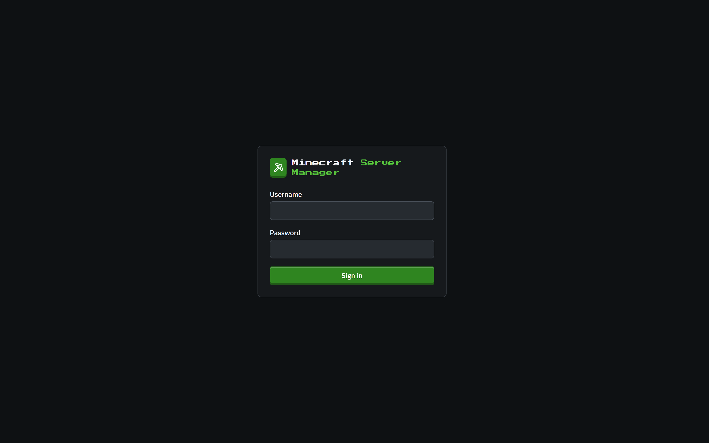

# Getting started

[← Back to docs index](README.md)

## First-run setup

The first time you open the panel, a short setup wizard walks you through it:

1. **System Check** makes sure Docker is reachable, Node.js is new enough, and the data folder is writable. If Docker isn't running yet you can still continue; creating and starting servers waits until it is.
2. **Create Your Admin Account**. This is the only account that exists until you add more, and it has full control. Pick a username (2 to 32 characters) and a password of at least 8 characters. You're signed in as soon as it's created.
3. **Panel Configuration** (optional): a public domain to show players in connect addresses, a CurseForge API key, and your time zone. All of it can be changed later in **Settings**.

The last step offers **Create a Server** or **Go to the Dashboard**.

> **Exposed installs are PIN-gated.** If you start the panel bound to a non-loopback address (`PANEL_HOST` other than `127.0.0.1`), the setup page also asks for a **6-digit PIN**. The panel prints it to its console on startup. Enter it along with your username and password. This stops a stranger who reaches the port first from claiming the admin account. The PIN disappears once the admin account exists.

## Signing in

After setup, the panel is protected by a login screen. Enter your username and password to continue.

If [two-factor authentication](two-factor-authentication.md) is enabled on your account, you'll be asked for a 6-digit code from your authenticator app right after your password.

## Finding your way around

Everything hangs off the left sidebar:

- **Dashboard** and **Servers**: every server at a glance ([details](dashboard.md)).
- **Library** (**Modpacks**, **Worlds**, **Blueprints**): what you install servers and content from.
- **Maintenance** (**Updates**, **Backups**, **Schedules**): the recurring care every server needs.
- **Insights** (**Health**, **Activity**, **Storage**): what happened, and what it costs in disk.
- **Panel Settings** (bottom, admins only): the public domain, time zone, defaults for new servers, [backup retention](backups.md#retention), mod site keys, and the public API.
- **Users & Permissions** (bottom, admins only): accounts and roles, two-factor resets, sign-in lockouts, and what each user may do on each server ([details](users-and-roles.md#per-server-permissions)).

Below those, **Jump to a Server** lists your servers. Opening one shows six sections: **Overview**, **Console**, **Players**, **Content**, **Data**, and **Settings**, most with related sub-tabs (for example, **Data → Backups** and **Settings → Configuration**). See [A single server](servers.md#a-single-server).

The top bar has the **Create a Server** button, a **theme toggle** (dark/light), and your **account menu**, where you can change your profile picture, manage [two-factor authentication](two-factor-authentication.md), or sign out.

## On a phone or tablet

Every page is laid out for a narrow screen first and widens from there: the sidebar tucks away behind the menu button, data tables stack into cards, toolbars wrap, and the world-controls rail collapses to a card you open when you need it. Buttons and chips have a real touch target size. Nothing is desktop-only.

Made for thumbs:

- A server's six sections (**Overview**, **Console**, **Players**, **Content**, **Data**, **Settings**) sit in a tab bar along the bottom of the screen. It steps aside while you type.
- Swipe left or right on a server page to move between the current section's sub-tabs (for example **Players → Inventory → Analytics**). Swipes that start in a text field, the console, a map or a sideways-scrolling table are left alone.
- Dialogs open as sheets from the bottom edge with full-width buttons.
- The keyboard doesn't capitalise or "correct" player names, commands, file names, addresses or searches, and its Enter key reads **Send** in the console and **Search** in search boxes.
- The console fits the screen height, keeps the command box above the keyboard, and shows a **New Lines** button when output arrives while you're scrolled up. **Keep Screen On** stops the phone from locking while you watch it.
- **Share** next to **Copy Address** on a server's Overview, and next to **Copy Invite Text** on **Players → Invites**, opens the phone's share sheet.
- If the panel stops answering (Wi-Fi drops, the panel restarts) a **Reconnecting…** banner says so, and goes away by itself once it answers again.

### Install it as an app

The panel installs like an app on phones, tablets and desktops: its own icon, full screen with no browser bars, and shortcuts to Servers, Health, Backups and Activity on a long press of the icon.

- **Android, Chrome or Edge on a computer:** open your account menu (top right) and choose **Install App**, or use the browser's own install button.
- **iPhone and iPad:** open the panel in Safari, choose **Install App** in the account menu for the steps, or tap **Share** and then **Add to Home Screen**.

Installing needs the panel to be served over HTTPS (or opened as `localhost`). Browsers refuse to install a site over plain HTTP, so on a LAN address without HTTPS the menu item does not appear.

Once installed:

- **Notify Me When Tasks Finish** in the account menu sends a system notification when a backup, restore, update or other background task finishes while the panel isn't on screen.
- The app icon shows a badge with the number of unread [health alerts](dashboard.md), where the system supports badges.
- There's no browser bar, so the top bar has a **Refresh** button, and pulling down from the top of a page reloads it.
- If the panel can't be reached, you get a clear offline screen with a **Try Again** button instead of a browser error. Nothing is cached that could show you out-of-date server data: every page and number still comes live from the panel.

### Small shortcuts

- Press <kbd>/</kbd> to jump to the search box on any page that has one.
- Each server section reopens on the sub-tab you last used: leave **Content** from **Worlds**, and **Content** brings you back to **Worlds**.
- While a background task runs, the browser tab's title starts with how many are running, for example "(1) Backups".
- A server's page shows its live status in the tab title, for example "🟢 Alpha Survival (Running) · MSM", so a start, stop or crash shows without switching tabs.
- The **star** on a server card pins it to the top of the dashboard, the server list and the sidebar (pins are kept per browser).
- The **address** on each server card, and the copy button beside each server in the sidebar, copy what players type to connect: your public domain when one is set (**Panel Settings → General**), otherwise this machine's LAN address.
- **Select** on the dashboard or server list picks several servers at once, then **Start**, **Restart**, **Stop** or **Back Up** runs on all of them.
- **Run Now** (the play button on a schedule) runs that task immediately, with the same warning and task tray as a timed run.
- A server's **Overview** shows when its next backup and next restart are due, counting panel-wide schedules too, and says plainly when no backup is scheduled.
- Backups can carry a **note** ("Before the 1.21 upgrade"): edit it with the pencil on a backup, and it shows under the archive name.
- A server with the live map on has a **Map** button on its card and **Open Live Map** in its Quick Actions.
- Deleting a schedule, a chat command, an IP ban or a console quick button shows **Undo** for ten seconds instead of asking "are you sure?" first.
- Leaving Discord, Status Page, Chatbot or a Panel Settings section with unsaved edits asks before the edits are lost.

  
  
  
  
  
  

## What you need

The panel talks to Docker to run servers, so it needs access to a Docker daemon (Docker Desktop or a Docker Engine socket). When Docker is reachable, the dashboard's Docker tile shows **Connected** and its version. If it's not, the panel still runs. You just can't start servers until the daemon is up.

## Next steps

- [Create your first server →](servers.md)
- [Secure your account with 2FA →](two-factor-authentication.md)
